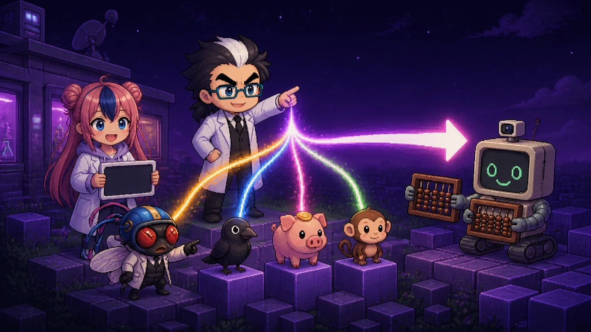

# 뉴럴링크는 왜 돼지와 원숭이 뇌에 칩을 심었나

**AI 연구실 해설 대시보드 · 초파리 특별편 4** — 글 · 안상선 ((주)M-Robo 대표)

일론 머스크가 세운 뉴럴링크가 돼지(2020)·원숭이(2021) 뇌에 칩을 심은 실험을, 초파리 배선도 시뮬레이션, 까마귀 뇌 연구, 테슬라 자율주행·YOLO, 자율비행 드론 설계까지 **한 줄의 파이프**(감각 → 인코더 → 뇌/모델 → 해독기 → 행동)로 나란히 놓고 직접 돌려 보는 인터랙티브 한국어 해설입니다. 박사 · 조수(하루) · 초파리 연구원 · 주판봇이 진행합니다.

| 파일 | 내용 |
|---|---|
| [index.html](index.html) | 목차 — 표지, 학습 목표, 섹션 바로가기 |
| [4_neuralink_animal_brain_ai.html](4_neuralink_animal_brain_ai.html) | 본편 (단일 HTML, 설치 없이 열림, 약 30분) |
| [prompts/](prompts/) | 표지·장면 그림 생성 지시문 (Genspark 등에 그대로 붙여 넣기) |
| `assets/img/` | 받은 그림을 넣는 곳 (비어 있으면 페이지가 대체 표지로 그림) |

## 본편 구성

| 섹션 | 내용 | 맡은 동물 / 사례 |
|---|---|---|
| 왜 동물의 뇌부터였나 | 안전·해독(사실) + 바로 반응하는 본보기(해석), 다섯 줄 파이프 비교표 | 전체 |
| 동물 뇌 대시보드 | 네 뇌를 회전·신호 흐름으로 보기, 센 범위를 밝힌 뉴런 수 막대(로그 눈금) | 초파리 · 까마귀 · 돼지 · 원숭이 |
| 모델 지도 | 퍼셉트론 · 다층 퍼셉트론 · CNN/YOLO · 해독기 · 강화학습 · end-to-end | — |
| ① 퍼셉트론 | 다가오면 뛰는 가장 작은 신경망 | 초파리 (돌리기) |
| ② CNN과 YOLO | 확신도 문턱, 정밀도·재현율 | 까마귀 (느끼기, 판정 보류) |
| ③ 해독기 | 아날로그 뇌 신호 → 디지털 데이터 → 다리 움직임 예측 | 돼지 거트루드 (읽기) |
| ④ 강화학습 | 보상(바나나 스무디)과 Q-러닝 퐁, RLHF 연결 | 원숭이 페이저 (배우기) |
| ⑤ end-to-end | 카메라에서 핸들까지 신경망 하나 | 테슬라 FSD v12 (비교) |
| 대결 | 채널을 다 쓸까, 잘 골라 쓸까 — 초파리 80.0% vs 주판봇 70.0% | 원숭이 퐁 해독기 |
| ⑥ 응용 | 학습한 인식 + 반사 + 비상 규칙으로 자율비행 드론, 뇌 신호 외골격 사례 | 드론 · 로봇 |
| 실험 결과 카드 | FlyWire, 까마귀 보고 뉴런, 거트루드, BrainEx, 페이저, FSD v12 (결과의 방향만 옮긴 도식) | — |
| 실습편 A~F | Colab 코드, AI 프롬프트, 용어, 비유 모음, 출처, 교육자 팁 | — |
| 지식 색인 · 꾸러미 | 검색·미니 그래프, 온톨로지·서지 ZIP(JSON-LD · Turtle · CSV · CSL-JSON · BibTeX · RIS) | — |

## 보는 법

- **GitHub Pages:** Settings → Pages → Deploy from a branch → `main` / `(root)`. 그러면 `index.html`이 첫 화면이 됩니다.
- **내 컴퓨터:** 저장소를 내려받아 `index.html`을 브라우저로 엽니다. 파일은 같은 폴더에 두어야 링크가 동작합니다.

## 그림 넣기

| 키 | 파일 | 지시문 | 상태 |
|---|---|---|---|
| `cover_index` | `assets/img/cover_index.webp` | [prompts/COVER_00_index.md](prompts/COVER_00_index.md) | 완료 (1600·960 WebP) |
| `cover_4` | `assets/img/cover_4.webp` | [prompts/COVER_4_neuralink.md](prompts/COVER_4_neuralink.md) | 완료 (1600·960 WebP) |
| 장면·컷 5장 | — | [prompts/IMG_4_neuralink.md](prompts/IMG_4_neuralink.md) | 대기 (페이지에 자리만 있음) |

표지는 WebP 1600×900(220 KB 이하)으로 위 경로에 올리면 페이지가 자동으로 바꿔 씁니다. 그림이 없어도 페이지는 완성 상태입니다.

## 정확성 표시

- 노란 도장(**설명용 모형 · 도식 · 예시값 · 개략 모형**)이 붙은 그림은 실제 측정값이 아닙니다.
- 뉴럴링크·테슬라의 "생각 읽기", "의식 옮기기" 같은 말은 당시 회사가 밝힌 **목표**이며 시연된 결과가 아닙니다.
- 까마귀 의식 연구는 신경 표지를 보였고 해석은 논의 중이라 대결 판정을 하지 않았습니다.
- 확인이 필요한 항목(테슬라 공식 자료 대조, 원숭이 뉴런 수 원 논문 표, 칩 위치 원자료)은 본편 꾸러미 섹션의 "확인 필요 목록"에 있습니다.

## 시리즈

- 초파리 특별편 ①~③: [adminmrobo/AI_Model_Review_Fruit_fly_special](https://github.com/adminmrobo/AI_Model_Review_Fruit_fly_special)

## 출처와 표기

주요 출처: Dorkenwald 외 (2024) *Nature* · Olkowicz 외 (2016) *PNAS* · Stacho 외 (2020), Nieder 외 (2020) *Science* · Jelsing 외 (2006) *J. Exp. Biol.* · Vrselja 외 (2019) *Nature* · Herculano-Houzel 외 (2007) *PNAS* · Redmon 외 (2016) CVPR · Benabid 외 (2019) *The Lancet Neurology* · 한겨레 · KT Enterprise · 동아사이언스 · CNN · Tom's Guide 보도 · Not a Tesla App 릴리스 노트. 전체 목록은 본편 바닥글과 꾸러미에 있습니다.

뉴럴링크·테슬라·마인크래프트는 각 회사의 상표이며, 이 저장소는 그 회사들과 관련이 없습니다. 기사 사진과 논문 그림은 쓰지 않고 새로 그렸습니다. 글꼴: IBM Plex Sans KR (Google Fonts, SIL Open Font License).
